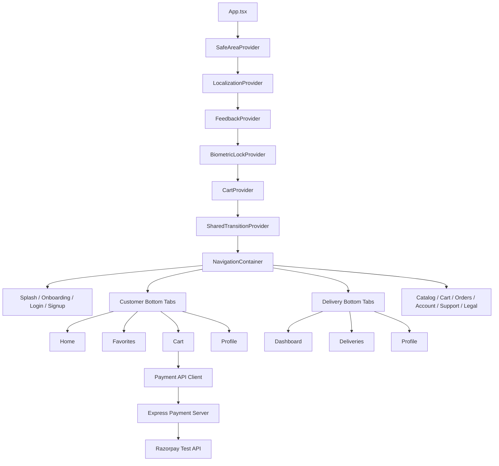

<div align="center">

# SmartMart

### Customer Shopping and Delivery Partner Mobile App

[](https://reactnative.dev)
[](https://react.dev)
[](https://www.typescriptlang.org)
[](https://reactnavigation.org)
[](#platform-support)
[](#razorpay-test-payment-flow)
[](#license)

<br/>

**A grocery marketplace prototype for customers and delivery partners**  
Discover products, build a cart, verify demo payments, manage orders, and switch into a delivery-partner workflow.

[Features](#features) • [App Preview](#application-preview) • [Architecture](#architecture) • [Customer App](#customer-experience) • [Delivery App](#delivery-partner-experience) • [Payment Server](#payment-server-api) • [Project Structure](#project-structure) • [Quick Start](#quick-start)

</div>

---

## Overview

SmartMart is a feature-rich React Native grocery marketplace prototype. It provides a customer shopping experience, sample order lifecycle, delivery-partner interface, localization, biometric locking, animations, and a small Razorpay payment verification server.

The repository is organized for a small-to-medium mobile application:

- Feature-first source directories
- Shared components and services
- Native Android and iOS projects
- Separate Express payment server
- React Navigation native-stack and bottom-tab navigation
- Context-based cart and app providers
- Static/demo data for features without a production backend

> **Current product status:** This is a UI and prototype implementation. Authentication, accounts, products, orders, addresses, payment methods, tracking, and delivery assignments use demo/static/local data unless explicitly backed by the included payment server.

---

## Features

### Authentication and onboarding

- Animated three-step onboarding flow
- Customer or delivery-partner role selection
- Country/phone-number input
- Client-side phone validation
- Demo OTP verification modal
- Fixed demo OTP: `1234`
- Splash screen animation
- Automatic role-specific navigation after verification
- Persistent biometric lock integration

### Customer discovery and catalog

- Animated address/location selector
- Current-location/address bottom sheet
- Home offer carousel with pagination dots
- Category grid and category navigation
- Best Deal horizontal product list
- Nearby product/shop list
- Order Again product list
- Cart quantity badge
- Product search entry
- Search and filtering
- Recent and popular search suggestions
- Category chips
- Price range filtering
- Animated result updates
- Product list and favorites views
- Product image, name, price, size, and rating
- Product details, description expansion, reviews, and recommendations

### Favorites and shared transitions

- Favorites initialized with sample products
- Favorite toggle behavior
- Animated product cards
- Shared product transition overlay
- Product-to-cart and product-to-shop navigation
- Return-route animation handling

### Cart

- Add, merge, increase, decrease, and remove products
- Clear-cart action
- Animated cart quantity controls
- Cart badge and item count
- Subtotal, savings, delivery fee, and total display
- Coupon entry and validation
- Empty-cart navigation state
- Checkout loading/error states
- Razorpay native checkout integration

### Coupons

| Coupon | Discount | Minimum subtotal |
|---|---:|---:|
| `SAVE10` | ₹10 fixed | ₹30 |
| `FRESH15` | 15%, capped at ₹15 | ₹40 |

Coupon validity is checked both in the mobile cart and again by the payment server.

### Orders

- All Orders
- Ongoing Orders
- Completed Orders
- Cancelled Orders
- Order list and status cards
- Order details
- Reorder bottom sheet
- Rate/review bottom sheet
- Live-chat navigation
- Five-stage static tracking timeline
- ETA presentation
- Delivery contact card
- Order actions based on status

### Account

- Profile summary
- Edit profile
- Photo/profile picker sheet
- Address list
- Add address
- Edit address
- Saved payment methods
- Add payment method
- Notification preferences
- App settings
- Logout confirmation sheet
- Account deletion confirmation sheet
- Privacy policy
- Terms of service

### Support

- Help and FAQ-style screen
- Live chat screen
- Support navigation from order/account screens

### Localization

- Shared localization provider
- Localized text and text-input controls
- Language registry
- English fallback
- Translation catalog
- Language picker
- Persistent language preference

### Security and privacy

- Biometric/device credential app lock
- Authentication-route awareness
- Background and foreground lock handling
- Server-side-only Razorpay secret
- Test-key and live-key safeguards
- Rate limiting and security headers on payment server

### Delivery partner experience

- Delivery dashboard
- Available delivery cards
- Active and assigned delivery states
- Delivery locations and order summary
- Delivery order details
- Earnings summary
- Payout history
- Vehicle-document management UI
- Delivery partner profile
- Partner logout behavior

### Visual and interaction system

- Custom animated tab icons
- Active-tab glow
- Native-stack transitions
- Home entrance animations
- Home skeleton loading cards
- Product/shared transition animations
- Bottom sheets
- Loading spinners
- Success, warning, and error feedback
- Platform-specific safe-area and tab-bar spacing

---

## Application Preview

The customer app currently does not contain a dedicated screenshot gallery in `docs/` or a `screenshots/` folder. Use the screen inventory below as the GitHub-ready feature map.

| Customer discovery | Shopping | Orders and account |
|:---:|:---:|:---:|
| Home offers and categories | Product search/details | My Orders and tracking |
| Nearby and order-again lists | Cart and coupons | Profile, address, and payments |
| Favorites and reviews | Razorpay test checkout | Delivery partner dashboard |

Screenshots can be added later under:

```text
Smart-Mart/docs/screenshots/
```

and linked in this section without changing application code.

---

## Technology Stack

| Layer | Technology |
|---|---|
| Framework | React Native 0.87.1 |
| UI library | React 19.2.3 |
| Language | TypeScript 6.0.3 |
| Navigation | React Navigation native-stack + bottom-tabs |
| Local state | React Context and hooks |
| Persistence | AsyncStorage for supported preferences/lock state |
| Payment SDK | react-native-razorpay |
| Biometrics | react-native-biometrics |
| Image picker | react-native-image-picker |
| Icons | Feather, Ionicons, and Material Icons |
| Safe areas | react-native-safe-area-context |
| Testing | Jest + react-test-renderer |
| Payment backend | Node.js + Express + Razorpay REST SDK |
| Security middleware | Helmet + express-rate-limit |

### Main dependencies

- `@react-navigation/native`
- `@react-navigation/native-stack`
- `@react-navigation/bottom-tabs`
- `@react-native-async-storage/async-storage`
- `react-native-razorpay`
- `react-native-biometrics`
- `react-native-image-picker`
- `react-native-safe-area-context`
- `react-native-screens`
- Vector icon packages from `@react-native-vector-icons`

---

## Architecture



### Provider responsibilities

| Provider | Responsibility |
|---|---|
| `SafeAreaProvider` | Safe area values and edge protection |
| `LocalizationProvider` | Language and translation state |
| `FeedbackProvider` | Shared success/error/feedback UI |
| `BiometricLockProvider` | App lock, native biometric prompt, lock state |
| `CartProvider` | In-memory customer cart state |
| `SharedTransitionProvider` | Product transition and overlay state |

### Navigation behavior

- Native-stack root navigation
- Customer and delivery bottom-tab navigators
- Hidden native headers
- Platform-specific transition animations
- 280 ms native-stack animations
- 240 ms bottom-tab animations
- Freeze inactive screens
- Navigation-state biometric gating
- Shared-transition return handling

---

## Customer Experience

## 1. Splash and onboarding

### Splash screen

- SmartMart logo/emblem
- Decorative launch items
- Loading/transition animation
- Automatic navigation after approximately 3.5 seconds

### Onboarding screen

- Three onboarding cards
- Introductory feature messaging
- Next button
- Skip button
- Transition into login

Supporting components:

- `OnboardingCard`
- `RoleSelector`
- `FloatingItems`

---

## 2. Authentication

### Login

- Customer/delivery role selector
- Country-code picker
- Phone input
- Phone-digit validation
- Demo OTP modal
- Customer navigation to MainNavigation
- Delivery navigation to DeliveryNavigation

### Signup

- Full name
- Persona/role
- Country code
- Phone number
- OTP verification
- Demo account completion

### Validation rules

- Phone number must contain 7–10 digits after punctuation and formatting are removed.
- Demo OTP must be `1234`.
- Names, countries, and role selections are validated in the demo flow.

> Login and signup do not call an authentication server and do not create a real account or JWT session.

---

## 3. Home

`HomeScreen` is the customer discovery hub.

### Address

- Animated address selector
- Address/current-location sheet
- Current-location visual state

### Search and cart

- Search entry navigates to search/filter
- Cart entry navigates to cart
- Cart badge displays total cart quantity

### Discovery

- Offer banner carousel
- Pagination indicators
- Category list/grid
- See All action
- Best Deal section
- Nearby section
- Order Again section

### Product interactions

- Open product details
- Add/favorite product actions
- Start shared product transition
- Navigate to shop details or reviews

---

## 4. Catalog

### CategoryListScreen

- Category cards
- Category selection
- Product-list navigation
- Visual category filtering

### ProductListScreen

- Product title
- Grid/list-like cards
- Product name
- Pack size
- Current price
- Original price
- Product image
- Favorite state
- Favorites variant using seeded data

### ProductDetailsScreen

- Image gallery
- Product information
- Current and original price
- Pack size
- Rating
- Product description
- Expand/collapse description
- Favorite toggle
- Add-to-cart action
- Buy-now action
- Similar products
- Reviews navigation
- Shop-details entry

### SearchAndFilterScreen

- Text search
- Recent searches
- Popular searches
- Category chips
- Price ranges
- Search result cards
- Empty-state messaging
- Animated list results

### ShopDetailsScreen

- Store identity
- Store information
- Shop products
- Shop rating or summary
- Product/review navigation

### ReviewsScreen

- Product or shop rating display
- Deterministic sample reviews
- Reviewer identity
- Star/rating presentation
- Review text

---

## 5. Cart and checkout

### Cart state

The `CartContext` stores:

- Product name/key
- Display size
- Current price
- Original/price metadata
- Image
- Quantity

It supports:

- Add
- Merge duplicate products
- Increment quantity
- Decrement quantity
- Remove
- Clear
- Calculate item quantity
- Calculate cart state

The current cart is memory-only and does not persist after an app restart.

### Cart screen interactions

- Animated item removal
- Quantity controls
- Coupon sheet/input
- Delivery fee
- Total calculation
- Savings display
- Empty cart state
- Checkout action
- Connection/server error display
- 15-second request timeout feedback
- Razorpay native checkout

### Checkout sequence

```text
Cart product names + quantities
    ↓
POST /api/payments/orders
    ↓
Server validates and recalculates total
    ↓
Razorpay native checkout
    ↓
Razorpay signature response
    ↓
POST /api/payments/verify
    ↓
Server verifies HMAC, order, payment, amount, and status
```

A verified checkout does not create a customer order, save delivery data, or update inventory.

---

## 6. Orders

### MyOrdersScreen

- Status tabs
- All/Ongoing/Completed/Cancelled lists
- Order cards
- Status badge
- Reorder action
- Rate action
- Cancel state
- Track order navigation
- Product summary

### OrderDetailsScreen

- Order identity
- Delivery/fulfillment status
- Item summary
- Price summary
- Reorder action
- Rating action
- Live-chat action
- Support/navigation actions

### TrackOrderScreen

- Five-stage timeline
- Current stage animation
- Estimated delivery time
- Order status
- Delivery partner contact card
- Static location/order presentation

### Rate/reorder components

- `RateOrderSheet`
- `ReorderSheet`
- Confirmation controls
- Demo updates only

---

## 7. Account and settings

### Profile

- Profile identity
- Navigation to edit profile
- Address menu
- Payment method menu
- Notifications menu
- Help/support menu
- Settings menu
- Logout

### Address

- Saved address list
- Add address
- Edit address
- Current-location selection
- Address deletion or confirmation sheets
- Static/demo local address values

### Payments

- Saved payment-method list
- Add card/UPI-style method UI
- Masked values
- Method selection UI

### Notifications

- Notification preference rows
- Toggle-style UI
- Local demo state

### Settings

- App preferences
- Language/navigation integration
- Biometric lock setting
- Legal links
- Logout/delete controls

---

## Delivery Partner Experience

## Delivery bottom navigation

| Tab | Screen | Purpose |
|---|---|---|
| Dashboard | `DeliveryDashboard` | Daily delivery metrics and actions |
| Deliveries | `DeliveriesScreen` | Available or assigned delivery list |
| Profile | `DeliveryProfileScreen` | Partner profile and navigation |

## Dashboard

The delivery dashboard includes:

- Total or active deliveries
- Completed deliveries
- Earnings summary
- Availability/status card
- Assigned order shortcuts
- Weekly/sample activity
- Navigation into delivery details
- Partner-specific feedback

## Deliveries

The deliveries screen includes:

- Delivery queue cards
- Pickup and delivery locations
- Order summary
- Status labels
- Accept/start action UI
- Navigate to order details
- Delivery-state changes
- Empty-state UI

## Delivery order details

- Full delivery order summary
- Customer address
- Pickup location
- Item/payment summary
- Contact action
- Navigation action
- Delivery status controls
- Proof/status UI

> GPS, live rider assignment, route optimization, real contact permissions, proof-of-delivery upload, and backend state synchronization are not implemented in this repository.

## Earnings

`EarningsScreen` provides:

- Earnings overview
- Total/available/pending values
- Earnings cards
- Delivery-period breakdown
- Navigation to payout history

## Payout history

`PayoutHistoryScreen` provides:

- Sample payout records
- Payout status
- Amount and date
- Settlement details
- Empty-state handling

## Vehicle documents

`DeliveryVehicleDocumentsScreen` includes:

- Vehicle/document identity UI
- Document upload/add controls
- Document status presentation
- Vehicle information
- Photo-picker integration

---

## Root Routes

| Route | Screen |
|---|---|
| `SplashScreen` | Splash |
| `OnBoardingScreen` | Onboarding |
| `LoginScreen` | Login |
| `SignupScreen` | Signup |
| `MainNavigation` | Customer tabs |
| `DeliveryNavigation` | Delivery tabs |
| `ProductDetailsScreen` | Product details |
| `ReviewsScreen` | Reviews |
| `ProductListScreen` | Product list/favorites |
| `ShopDetailsScreen` | Shop details |
| `CategoryListScreen` | Categories |
| `CartScreen` | Cart |
| `SearchAndFilterScreen` | Search/filter |
| `AddressScreen` | Saved addresses |
| `AddEditAddressScreen` | Add/edit address |
| `EditProfileScreen` | Edit profile |
| `MyOrdersScreen` | My Orders |
| `OrderDetailsScreen` | Order detail |
| `TrackOrderScreen` | Order tracking |
| `PaymentMethodsScreen` | Payment methods |
| `AddPaymentMethodScreen` | Add payment method |
| `NotificationsScreen` | Notifications |
| `HelpScreen` | Help |
| `LiveChatScreen` | Live chat |
| `SettingsScreen` | Settings |
| `PrivacyPolicyScreen` | Privacy policy |
| `TermsOfServiceScreen` | Terms of service |
| `EarningsScreen` | Delivery earnings |
| `PayoutHistoryScreen` | Delivery payouts |
| `DeliveryOrderDetailsScreen` | Delivery order detail |
| `DeliveryVehicleDocumentsScreen` | Vehicle documents |

---

## Customer Bottom Tabs

| Tab | Icon | Component |
|---|---|---|
| `Home` | Home | `HomeScreen` |
| `Favorites` | Heart | Seeded `ProductListScreen` |
| `Cart` | Shopping bag | `CartScreen` |
| `Profile` | User | `ProfileScreen` |

The favorites tab is initialized with four sample products:

- Surf Excel Easy Wash Detergent Powder
- Fresh Apples
- Amul Taaza Toned Milk
- Tata Tea Premium

---

## Delivery Bottom Tabs

| Tab | Component |
|---|---|
| `Dashboard` | Delivery dashboard |
| `Deliveries` | Deliveries list |
| `Profile` | Delivery profile |

---

## Razorpay Test Payment Flow

The customer cart uses Razorpay React Native SDK with a separate Express test server.

### Mobile client

Location:

```text
src/features/cart/services/paymentApi.ts
```

Behavior:

- Base URL defaults to `http://localhost:4001`
- Creates Razorpay orders through the server
- Opens native Razorpay checkout
- Sends the payment signature to the verification endpoint
- Uses a 15-second fetch timeout
- Shows connection-specific and server-specific errors
- Rejects malformed server order responses
- Accepts only `rzp_test_` key IDs on the client

### Server

Location:

```text
server/src/
```

Files:

- `app.js`: Express application and endpoints
- `paymentDomain.js`: INR catalog, coupon, quantity, and signature rules
- `server.js`: environment validation and server startup

### Server startup requirements

- `RAZORPAY_KEY_ID`
- `RAZORPAY_KEY_SECRET`

Only test-mode keys beginning with `rzp_test_` are allowed. Live keys beginning with `rzp_live_` are rejected to prevent accidental live charges.

### Security controls

- Helmet security headers
- 10 KB JSON request limit
- Payment rate limiting: 20 requests per minute
- Hides the `x-powered-by` header
- Server-authoritative prices and coupon validation
- HMAC SHA-256 signature validation
- Timing-safe signature comparison
- Payment and order status verification
- Payment capture verification

---

## Payment Server API

## `GET /health`

Health check endpoint.

Response:

```json
{
  "status": "ok"
}
```

## `POST /api/payments/orders`

Creates a server-calculated Razorpay order.

Request:

```json
{
  "items": [
    {
      "productName": "Fresh Apples (Fuji)",
      "quantity": 2
    }
  ],
  "couponCode": "SAVE10"
}
```

Response:

```json
{
  "orderId": "order_xxx",
  "amount": 1080,
  "currency": "INR",
  "keyId": "rzp_test_xxx"
}
```

The server:

- Rejects empty and oversized item lists
- Rejects unknown products
- Limits each product to 20 units
- Rejects duplicate aggregated quantities above 20
- Recalculates subtotal
- Adds a ₹2.50 delivery fee
- Applies coupon rules
- Returns an amount in paise

## `POST /api/payments/verify`

Request:

```json
{
  "orderId": "order_xxx",
  "paymentId": "pay_xxx",
  "signature": "64-character-hmac"
}
```

The server validates:

- Signature format
- HMAC SHA-256 signature
- Payment/order relationship
- Currency
- Payment amount
- Authorized/captured status
- Order paid status
- Captured/paid amount

---

## Server Product Catalog

The payment server maintains its own authoritative product list in:

```text
server/src/paymentDomain.js
```

When the cart catalog changes:

1. Add/update the product name in the server catalog
2. Add/update the unit price in paise
3. Keep the mobile payment item name identical to the server key
4. Add server and mobile tests

The mobile app and server use product names as identifiers for the payment demo. Production implementations should use stable product/SKU IDs.

---

## Data and Persistence

| Data | Current behavior |
|---|---|
| Cart items | React context memory only |
| Customer auth | Demo OTP; no backend session |
| Product catalog | Static TypeScript/sample data |
| Favorites | Sample/static state |
| Orders | Static/sample UI state |
| Order tracking | Static five-stage timeline |
| Addresses | Local/demo UI |
| Payment methods | Local/demo UI |
| Delivery jobs | Static/demo UI |
| Earnings/payouts | Static/sample values |
| Language preference | Persisted by localization integration where implemented |
| Biometric setting | AsyncStorage |
| Live payment state | Razorpay server verification only |

The app does not currently include a database, REST account service, real-time order service, or persistent backend.

---

## State Management Details

### CartContext

Provides:

- Cart item array
- `addItem`
- `updateQuantity`
- `removeItem`
- `clearCart`
- Total item count

### BiometricLockProvider

Provides:

- Authentication/lock state
- Native availability checks
- Biometric/device credential prompt
- Route-based lock decisions
- Background/foreground lock behavior

### SharedTransitionProvider

Provides:

- Active product/transition item
- Show/hide functions
- Shared overlay navigation targets
- Return-route synchronization

### LocalizationProvider

Provides:

- Active language
- Translation lookup
- Language switching
- English fallback behavior

### FeedbackProvider

Provides:

- Shared app feedback UI
- Success/error presentation
- Confirmation interactions
- Overlay integration

---

## Localization

The language system is in:

```text
src/shared/i18n/
```

Files:

- `languages.ts` — supported language registry
- `translations.ts` — translation catalog
- `LocalizationProvider.tsx` — provider/state
- `LocalizedText.tsx` — localized text component
- `LocalizedTextInput.tsx` — localized input component
- `translations.test.ts` — fallback/translation tests

### Adding a language

1. Add the language code and native name to `SUPPORTED_LANGUAGES`.
2. Add the language catalog to `TRANSLATIONS`.
3. Use `LocalizedText` and `LocalizedTextInput`.
4. For dynamically assembled text, add the complete English phrase to the source catalog.
5. Add fallback and translation tests.

English is used when a phrase does not exist in the selected language.

---

## Project Structure

```text
Smart-Mart/
├── App.tsx
├── index.js
├── app.json
├── package.json
├── babel.config.js
├── metro.config.js
├── jest.config.js
├── tsconfig.json
├── android/
├── ios/
├── __tests__/
├── __mocks__/
├── server/
│   ├── package.json
│   ├── src/
│   │   ├── app.js
│   │   ├── paymentDomain.js
│   │   └── server.js
│   └── test/
└── src/
    ├── app/
    │   └── navigation/
    ├── assets/
    │   ├── fonts/
    │   └── images/
    ├── features/
    │   ├── account/
    │   ├── auth/
    │   ├── cart/
    │   ├── catalog/
    │   ├── delivery/
    │   ├── home/
    │   ├── legal/
    │   └── support/
    ├── shared/
    │   ├── components/
    │   ├── constants/
    │   └── i18n/
    └── types/
```

### Feature ownership

Feature-specific screens, components, and data remain inside their feature directory. A component belongs in `shared/` only when it is reused across multiple features.

---

## Android Setup

### Native configuration

- Application ID: `com.smart`
- Minimum SDK: 24
- Target SDK: 36
- Compile SDK: 37
- NDK: `27.1.12297006`
- Internet permission
- Biometric permission
- Image/photo permission configuration
- Debug and release build variants
- Debug keystore included in current project setup
- ProGuard/R8 minification disabled in current release configuration

### Android commands

```bash
npm start
npm run android
```

For payment server access, reverse the local port:

```bash
adb reverse tcp:4001 tcp:4001
```

---

## iOS Setup

The iOS project is named `Smart`.

### Native declarations

- Face ID usage description
- Camera usage description
- Photo-library usage description
- Location usage description
- Portrait phone orientation support
- Arbitrary local networking support for development
- CocoaPods/native auto-linking
- New Architecture enabled
- Registered asset/font links

### iOS commands

```bash
bundle install
bundle exec pod install
npm run ios
```

The simulator can normally reach the payment server at:

```text
http://localhost:4001
```

A physical iPhone requires a reachable HTTPS/development API host.

---

## Quick Start

## 1. Prerequisites

- Node.js 22.11 or newer
- npm
- Android Studio or Android SDK
- Xcode and CocoaPods for iOS
- React Native development environment
- Razorpay test account for payment testing

## 2. Install mobile dependencies

```bash
cd Smart-Mart
npm install
```

## 3. Start Metro

```bash
npm start
```

## 4. Run Android

```bash
npm run android
```

## 5. Run iOS

```bash
bundle install
bundle exec pod install
npm run ios
```

## 6. Configure payment server

Create the server environment file from the example, if present:

```bash
cp server/.env.example server/.env
```

Configure server-only values:

```text
RAZORPAY_KEY_ID=your_rzp_test_key
RAZORPAY_KEY_SECRET=your_server_secret
PORT=4001
```

Never place the secret key inside React Native source or the mobile app.

## 7. Start payment server

```bash
npm install --prefix server
npm --prefix server start
```

Expected server URL:

```text
http://localhost:4001
```

## 8. Android port forwarding

```bash
adb reverse tcp:4001 tcp:4001
```

## 9. Rebuild native dependencies

After installing Razorpay or changing native dependencies:

```bash
# Android
npm run android

# iOS
bundle exec pod install
npm run ios
```

---

## Scripts

### Mobile app scripts

| Command | Purpose |
|---|---|
| `npm start` | Start Metro |
| `npm run android` | Build and run Android |
| `npm run ios` | Build and run iOS |
| `npm run lint` | Run ESLint |
| `npm test` | Run Jest tests |

### Payment server scripts

| Command | Purpose |
|---|---|
| `npm --prefix server start` | Start Express payment server |
| `npm --prefix server test` | Run Node server tests |
| `npm install --prefix server` | Install server dependencies |

---

## Tests

### Mobile tests

The test setup includes:

- App rendering smoke test
- Authentication validation tests
- Biometric navigation gating tests
- Localization fallback tests
- Razorpay SDK mock
- React Native Jest configuration

Test locations:

```text
__tests__/
src/features/auth/utils/authValidation.test.ts
src/features/auth/biometrics/authenticatedNavigation.test.ts
src/shared/i18n/translations.test.ts
```

### Payment server tests

The server uses Node's built-in test runner.

Coverage includes:

- Health endpoint
- Order creation
- Unknown products
- Duplicate products
- Item and quantity limits
- Coupon validation
- Invalid signatures
- Payment verification mismatch
- Authorized/captured payment handling

Run:

```bash
npm test
npm --prefix server test
```

---

## Current Limitations

### Authentication

- Demo OTP is fixed to `1234`
- No real registration or account backend
- No JWT access/refresh session
- No password reset
- No SMS provider
- No server-side customer authorization

### Data persistence

- Cart does not persist across app restarts
- Addresses are local/demo UI
- Payment methods are local/demo UI
- Favorites are seeded/static
- Orders do not come from an API
- Order tracking is simulated
- Delivery assignments are not live
- Vehicle-document data is local/demo

### Payments

- Payment server only accepts test credentials
- Verified payment does not create or persist an order
- Verified payment does not create a delivery
- Refund, cancellation, reconciliation, and invoice flows are absent

### Backend

- No user/order/cart/inventory database
- No REST customer service
- No real-time WebSocket order updates
- No push notifications
- No delivery assignment service
- No live GPS/routing service
- No server-backed address/payment method storage

### Release readiness

- Debug/native signing details need production review
- API URL must be configured for real devices
- HTTPS/deployment is required outside local development
- Native permissions require production review
- App Store privacy declarations need verification
- Crash and production analytics integrations need configuration

---

## Production Integration Roadmap

### Identity and accounts

- Customer/vendor/delivery registration API
- OTP/SMS provider
- Secure JWT/OIDC sessions
- Password reset and account recovery
- Role-based server authorization

### Commerce

- Central product and category database
- Store inventory and stock reservation
- Persistent cart
- Stable product/SKU IDs
- Persistent customer orders
- Coupon management and promo rules

### Payments and accounting

- Production payment environment
- Webhook-driven payment updates
- Idempotency keys
- Refund and cancellation API
- Payment reconciliation
- Invoice/receipt service
- Tax and delivery fee ledger

### Delivery

- Live rider assignment
- Pickup and delivery status APIs
- Live GPS and route tracking
- Customer ETA updates
- Proof of delivery
- Rider earnings and payout ledger

### Reliability

- Push notifications
- Real-time WebSocket/SSE updates
- Offline queue/sync
- Retry/circuit-breaker handling
- Audit logs
- Error monitoring
- Production observability

---

## Adding or Modifying Features

Keep changes consistent with the existing feature structure.

### Add a customer screen

1. Create a folder under `src/features/<feature>/screens`
2. Add supporting components under the feature
3. Register the screen in `src/app/navigation/RootNavigation.tsx`
4. Add navigation parameters or route types where needed
5. Add an icon entry if it belongs to a bottom tab
6. Add the screen to Jest coverage

### Add a shared component

Place it in `src/shared/components` only when multiple features use it.

### Add localization

1. Register the language in `languages.ts`
2. Add translations to `translations.ts`
3. Use localized controls
4. Test fallback behavior

### Add payment products

1. Add/update the server catalog
2. Confirm client/server product names match
3. Add server quantity/price tests
4. Rebuild the app if native payment dependencies changed

---

## Troubleshooting

### Payment server cannot be reached

- Start the server with `npm --prefix server start`
- Check that port 4001 is not occupied
- On Android, run `adb reverse tcp:4001 tcp:4001`
- For a physical iPhone, use a reachable HTTPS/development host
- Update `PAYMENT_API_BASE_URL` in `src/features/cart/services/paymentApi.ts`

### Razorpay checkout fails

- Confirm test credentials are configured only on the server
- Confirm the key ID starts with `rzp_test_`
- Confirm live keys have not been enabled
- Rebuild native projects after SDK changes
- Run iOS pods again if native modules were modified

### iOS build fails after dependency changes

```bash
bundle exec pod install
npm run ios
```

### Android build fails

- Verify SDK 36/37 are installed
- Verify the configured NDK is installed
- Clear Metro cache if stale assets/modules remain
- Rebuild native dependencies and restart Metro

### OTP does not work

This app uses demo OTP only. Enter `1234`.

---

## Full Documentation

A repository-level documentation file contains expanded source and architecture details:

- `SMARTMART_COMPLETE_SYSTEM_DOCUMENTATION.md`

This README is the GitHub-facing summary and implementation guide for the Smart-Mart customer/delivery app.

---

## License

This project is proprietary unless a license is explicitly added to the repository.

Do not publish Razorpay secrets, signing credentials, private API keys, customer data, or private vendor/employee data.
